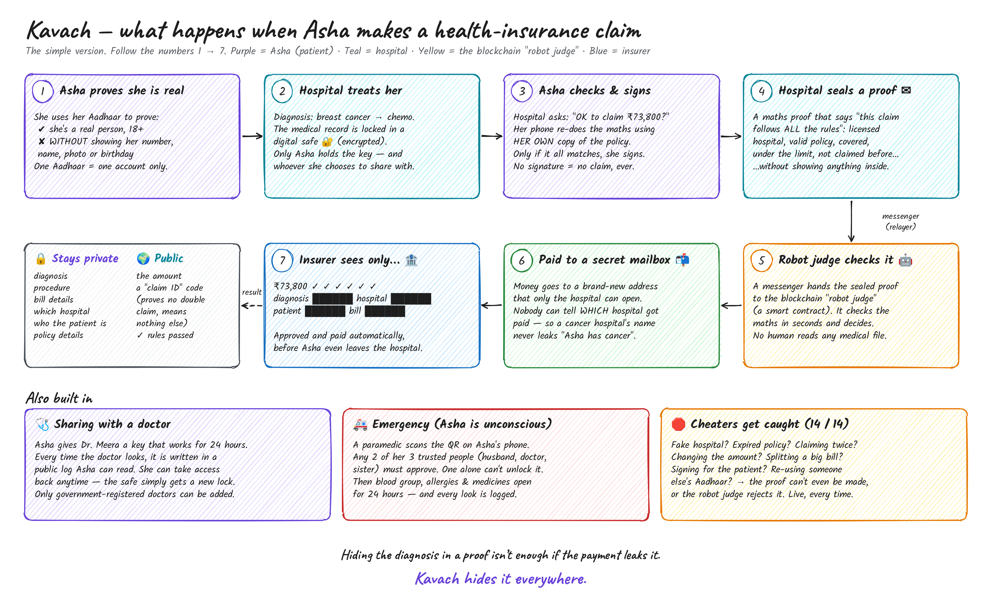
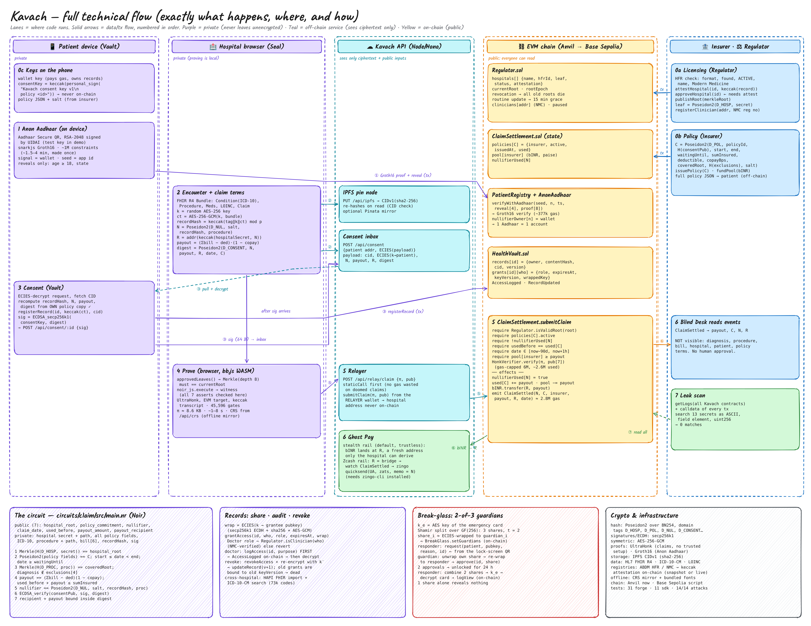

<div align="center">

# Kavach · कवच

### Insurers pay. Diagnoses stay sealed.

**Privacy-preserving health records and zero-knowledge insurance claims**
Hackasol 5.0 · Track 4 (Web3) · W3-01

`Noir` · `UltraHonk` · `Solidity` · `Anon Aadhaar` · `IPFS` · `HL7 FHIR R4` · `ABDM` · `React`

</div>

---

A hospital proves a health-insurance claim is valid with a **zero-knowledge proof generated in its own browser**.
A smart contract verifies it and pays in seconds. The insurer never sees the diagnosis, the procedure, the bill,
or **which hospital** filed it, and the **payment doesn't leak it either**. Patients own their records, approve
every claim, and can unlock an emergency card through 2-of-3 guardians.



## Why

To get a cashless claim paid today, a hospital sends the insurer the diagnosis, prescriptions and itemised bills,
and someone reads them by hand. That is a privacy risk, it is slow, and it is open to fraud.

Hiding the diagnosis inside a ZK proof isn't enough on its own. If the contract then pays the public wallet of an
oncology, IVF or HIV clinic, **the payment itself reveals the diagnosis**. Kavach hides the hospital inside a Merkle set
of all licensed hospitals, pays a **fresh one-time address** (or a Zcash shielded address) per claim, and submits
through a **relayer**, so not even the transaction sender identifies the hospital.

## Quick start

```bash
pnpm install
./scripts/demo.sh            # fresh local chain → deploy → seed → API :8787 → app http://localhost:5173
```

Prerequisites: Node 20+, pnpm, [Foundry](https://book.getfoundry.sh), and `nargo` 1.0.0 (`noirup`). The prover (`bb`) ships
inside `@aztec/bb.js`.

Anon Aadhaar onboarding uses proofs generated once per patient (snarkjs takes about 1.5–4 minutes on a laptop):

```bash
node sdk/scripts/aadhaar-prove.mjs <patient-wallet-address>
```

### Presenting: Story mode

The app opens on **Story mode**: the patient's phone, the hospital desk and the insurer's screen side by side, with a
"wire" strip showing exactly what crosses between them. Press **→** to run each step for real:

| Key | Action |
|---|---|
| `→` / `Space` | run the current step, then advance |
| `←` | previous step |
| `1` `2` `3` | zoom patient / hospital / insurer |
| `X` | x-ray: tag every field private or public |
| `R` | restart the story |
| `?` | show keys |

After the first run the app works offline: fonts are bundled and the prover's CRS is mirrored by the API.

## How it works



1. **Identity:** the patient proves with **Anon Aadhaar** that they hold a genuine UIDAI-signed Aadhaar and are 18+,
   revealing only their state. The proof is bound to their wallet, and an app-scoped nullifier allows one Aadhaar per account.
2. **Policy:** the insurer issues a policy. Only a Poseidon2 **commitment** goes on-chain; the terms never change afterwards.
   The patient's key inside it is a per-policy **consent key** derived from a wallet signature, so it is never on-chain.
3. **Encounter:** the hospital writes an HL7 FHIR R4 record, encrypts it with AES-256-GCM, and pins it to IPFS.
   The consent request is ECIES-sealed to the patient.
4. **Consent:** the patient's device re-derives the payout, claim ID and signed digest from its own policy copy,
   then signs the exact terms.
5. **Proof:** the hospital proves seven statements in zero knowledge, in the browser.
6. **Settlement:** a relayer submits. `ClaimSettlement` checks the registry root, policy, nullifier, prior usage, date and pool,
   verifies the UltraHonk proof, and pays bINR to a one-time address.
7. **Insurer view:** amount + six checks. Diagnosis, procedure, bill, hospital and patient stay hidden.
8. **Leak scan:** every transaction and event on-chain is searched for each private value. Result: 0 matches.

### The circuit — `circuits/claim/src/main.nr`

| # | Statement proven | How |
|---|---|---|
| 1 | Hospital is licensed | knows a secret whose leaf `Poseidon2(D_HOSP, secret)` is in the regulator's Merkle root |
| 2 | Policy active on the claim date | opens the policy commitment; `start ≤ date < end`, past the waiting period |
| 3 | Procedure covered, diagnosis not excluded | covered-set Merkle root inside the commitment + exclusion list |
| 4 | Payout correct and within the limit | `payout = (Σbill − deductible)·(1 − copay)`; `used_before + payout ≤ sum insured` |
| 5 | Not claimed before | `nullifier = Poseidon2(D_NUL, salt, recordHash, procedure)` |
| 6 | Patient consented | secp256k1 signature over the exact terms, verified in-circuit |
| 7 | Payout can't be redirected | recipient + amount are public inputs bound into the signed digest |

**Public inputs (7):** hospital root · policy commitment · nullifier · claim date · used before · payout · recipient.
**45,596 gates**, about 8.6 KB proof, about 1–8 s to prove, about 2.8M gas to verify and settle.

### Contracts — `contracts/src`

| Contract | Responsibility |
|---|---|
| `Regulator` | ABDM HFR-attested hospital listings, Merkle root (instant revocation of old roots), NMC-verified clinicians, insurers, pause |
| `ClaimSettlement` | immutable policy commitments, insurer pools, `submitClaim` (nullifiers, usage, date window, proof), payout |
| `HonkVerifier` | generated UltraHonk verifier for the claim circuit |
| `PatientRegistry` | Anon Aadhaar verification: one Aadhaar = one account |
| `HealthVault` | record hashes + CIDs, time-bound role grants with wrapped keys, `AccessLogged` audit trail, re-key on revoke |
| `BreakGlass` | 2-of-3 guardian emergency access with Shamir shares re-wrapped to the responder, 24 h window, logged views |
| `BINR` | demo rupee stablecoin (2 decimals = paise) |

## Features

| | |
|---|---|
| **Patient Vault** | Anon Aadhaar identity · encrypted FHIR records · share for 1h/24h/7d · revoke = re-encrypt · on-chain audit trail · consent inbox · emergency QR + guardians |
| **Hospital Seal** | ICD-10 smart search (73k codes, plain-language terms) · HAPI FHIR import · itemised bill · in-browser proof with live progress · Ghost Pay receivables |
| **Insurer Blind Desk** | pool, auto-settled claims (amount + checks only), policy issuance and renewal |
| **Doctor** | sees only records shared with them, only while access lasts; every open is logged first |
| **Regulator** | ABDM HFR check → attest → approve → publish root · revoke · NMC clinicians · emergency pause |
| **Break-glass** | responder request → 2 of 3 guardians release shares → card opens for 24 h |
| **Attack Lab** | 15 one-click fraud attempts against the real circuit and contracts |
| **X-Ray** | hospital's private witness next to the public chain + full-chain leak scan |

## Security

**Attack Lab: 14 / 14 attacks blocked** (plus an honest control claim that settles).

| Stopped by the circuit (no proof can exist) | Stopped by the contract |
|---|---|
| unlicensed hospital · expired policy · waiting period · uncovered procedure · excluded diagnosis · over the limit · forged patient consent | replay · lying about prior usage · inflated payout · front-run recipient · forged registry root · duplicate Aadhaar · stolen Aadhaar proof |

Threat model: [`docs/THREAT_MODEL.md`](docs/THREAT_MODEL.md) · architecture: [`docs/architecture.png`](docs/architecture.png)

## Tests

```bash
cd circuits/claim && nargo test             # circuit helpers
cd sdk && npx tsx --test test/claim.test.ts # 11 · real proof + 9 circuit-level attacks
cd contracts && forge test                  # 31 · real UltraHonk + real Anon Aadhaar proofs, attacks, flows
cd sdk && npx tsx scripts/leak-test.ts      # settles a claim, scans the entire chain for 16 private values
cd e2e && node story.mjs                    # Story mode end-to-end, keyboard only
cd e2e && node smoke.mjs --attacks          # every screen + all Attack Lab scenarios in Chromium
cd e2e && node flows.mjs                    # share → audited open → revoke/re-key · break-glass · renewal
```

## Configuration

| Variable | Effect |
|---|---|
| `RPC_URL`, `CHAIN_ID`, `ROLE_KEYS` | run against another chain (`scripts/deploy-testnet.sh` deploys to Base Sepolia) |
| `HFR_LOOKUP_URL`, `ABDM_ACCESS_TOKEN` | live ABDM Health Facility Registry checks (otherwise a labelled offline snapshot) |
| `NMC_LIVE=1`, `NMC_DOCTOR_ID` | live NMC Indian Medical Register lookup |
| `PINATA_JWT` | mirror IPFS blobs to a public pinning service |
| `ZINGO_CLI` | Zcash light wallet for shielded Ghost Pay payouts |
| `AADHAAR_PUBKEY_HASH` | switch Anon Aadhaar from the UIDAI test key to production |

## Status

| Live | Demo / test mode |
|---|---|
| ZK claim proofs, all contracts, encryption, consent, relayer, one-time payouts, audit trail, break-glass, Attack Lab, leak scan, HAPI FHIR import, ICD-10 search | local chain (Base Sepolia script ready) · Anon Aadhaar with the UIDAI **test** key and pre-generated proofs · HFR/NMC against an offline snapshot · IPFS pinned on the API node · bINR demo token · synthetic people, hospital registry ids and policies · Zcash leg awaits a wallet |

**Roadmap:** unlinkable claims per policy (policies in a Merkle tree) · production UIDAI key · ABDM sandbox and NMC credentials ·
MetaMask for patients · Base mainnet · e₹/UPI settlement rail.

## Layout

```
circuits/claim   Noir claim circuit
contracts/       Foundry contracts, tests (real proof fixtures), deploy script
sdk/             TypeScript core: Poseidon2, Merkle, policy, claim, prover, records crypto, FHIR, registries, scripts
server/          Hono API: IPFS node, consent inbox, relayer, Ghost Pay bridge, registries, ICD-10, FHIR import, CRS mirror
app/             Vite + React app: Story mode + 6 role screens + Attack Lab + X-Ray
e2e/             Playwright suites, diagram + deck generators
docs/            diagrams, architecture, threat model, concept
pitch/           pitch deck (HTML + PDF)
JOURNAL.md       build journal
```

## Built with

[Noir](https://noir-lang.org) · [Barretenberg / bb.js](https://github.com/AztecProtocol/aztec-packages) ·
[Anon Aadhaar](https://github.com/anon-aadhaar/anon-aadhaar) (MIT; contracts in `contracts/src/AnonAadhaar*.sol` and test assets in `sdk/assets/anon-aadhaar`) ·
[Foundry](https://getfoundry.sh) · [ethers](https://docs.ethers.org) · [Hono](https://hono.dev) · [React](https://react.dev) + [Vite](https://vitejs.dev) ·
[Tailwind CSS](https://tailwindcss.com) · [lucide](https://lucide.dev) · [multiformats](https://github.com/multiformats/js-multiformats) ·
ICD-10-CM code list · [HAPI FHIR](https://hapi.fhir.org) public test server

## License

MIT
