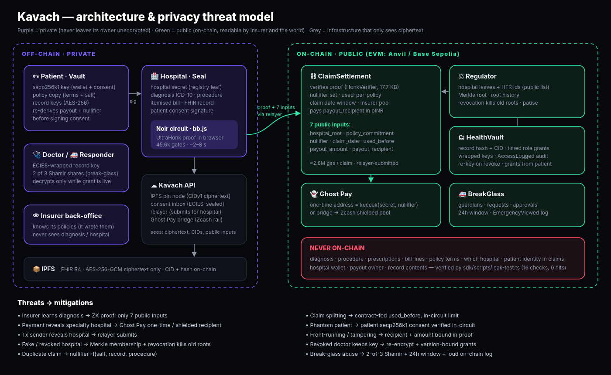

# Kavach — privacy threat model

## Data placement

| Data | Lives | Who can read it |
|---|---|---|
| Diagnosis (ICD-10), procedure, prescriptions, bill lines | Hospital device; inside encrypted FHIR on IPFS | Hospital, patient, grantees while their grant is live |
| FHIR record ciphertext | IPFS (CIDv1) | Everyone (useless without the key) |
| Record hash + CID | `HealthVault` | Everyone |
| Record key | Patient device; ECIES-wrapped per grantee on-chain | Patient; each grantee with their own private key |
| Policy terms (dates, limits, co-pay, covered set, exclusions, salt) | Patient + insurer | Patient, insurer |
| Policy commitment | `ClaimSettlement` | Everyone (Poseidon2, salted) |
| Amount already used per policy | `ClaimSettlement` | Everyone (needed to stop claim splitting) |
| Hospital secret | Hospital | Hospital only |
| Approved-hospital list (leaves, HFR ids) | `Regulator` | Everyone (licences are public) |
| Which hospital filed a claim | Nowhere | Nobody |
| Payout recipient | One-time address / Zcash shielded | Only the hospital can link it |
| Claim tx sender | Relayer | Everyone (reveals nothing about the hospital) |
| Emergency card key | 3 Shamir shares wrapped to guardians | Any 2 guardians → responder |

## Adversaries and mitigations

| Adversary | Goal | Mitigation | Tested by |
|---|---|---|---|
| Curious insurer | Learn diagnosis | Only 7 public inputs, all hashes or amounts | `leak-test.ts`, X-Ray |
| Chain observer | Infer diagnosis from *which hospital got paid* | Ghost Pay + hospital hidden in Merkle set + relayer | `leak-test.ts` (hospital name/HFR/leaf/wallet: 0 hits) |
| Fraudulent clinic | Claim without a licence | Merkle membership of `H(secret)` | Attack Lab "Unlicensed hospital" |
| Revoked hospital | Use an old root | Revocation bumps root epoch, so every older root dies | `test_attack_revokedRootDiesImmediately` |
| Dishonest hospital | Bill a patient who wasn't treated | Patient's secp256k1 signature over exact terms, checked in-circuit | Attack Lab "Fake patient consent" |
| Dishonest hospital | Bill twice | Nullifier `H(salt, record, procedure)` | Attack Lab "Replay" |
| Dishonest hospital | Split a big bill under the cap | Contract supplies `used_before`; proof enforces `used + payout ≤ limit` | Attack Lab "Lie about prior usage", "Over the limit" |
| Dishonest hospital | Bill excluded or uncovered care | Covered-set Merkle + exclusion list in circuit | Attack Lab |
| MEV / front-runner | Redirect payout or change amount | Recipient + amount are public inputs bound by the proof and the patient's consent | Attack Lab "Front-run", "Inflate" |
| Revoked doctor | Keep reading | Re-encrypt on revoke; grants bound to record version | `flows.mjs`, `test_rekeyInvalidatesOldGrants` |
| Rogue responder | Read records anytime | Needs 2 of 3 guardian shares (cryptographic), 24h window, every view logged | `flows.mjs`, `test_breakGlass_needsTwoGuardians` |
| API server | Read medical data | Sees only ciphertext: IPFS blobs, ECIES-sealed consent requests | design |
| Griefer | Burn relayer gas with junk proofs | Relayer simulates first; verifier call gas-capped at 6M | `test_attack_tamperedProofBytes` |

## Known trade-offs (stated openly)

- **Policy-level linkability**: the commitment is public so the contract can track `used`; an observer can count
  claims per (anonymous) policy. Roadmap: policies in a Merkle tree with spending tracked by note nullifiers.
- **Patient public key** is visible on-chain via the Vault's key registry (like any wallet that has sent a tx).
  It never appears in claim txs, and inside the policy it's only a salted hash. Roadmap: separate per-policy consent keys.
- **Zcash bridge is custodial** at the moment of conversion. The stealth rail is fully trustless.
- **Regulator is trusted** to publish a correct root. Mitigated by public auditability: anyone can recompute it (the Regulator screen does).
- **Gas**: ~2.8M per claim (UltraHonk, no trusted setup). Cents on Base. Groth16 would be ~10× cheaper but needs a ceremony.
